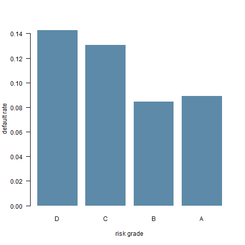
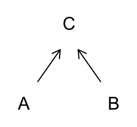

This post is the third in an occasional series about paradoxes in credit risk.

I used to work in credit risk model validation, and one thing I noticed when validating models is that you sometimes observe more defaults in the highest risk grade than in the second highest risk grade. In this post I want to explain why the paradox occurs and how I finally found out what it's called.

Let me explain the issue in more detail. In credit risk, one of the main problems is to estimate the probability that a loan will defualt. This is called PD (probability of default). Once the PD values have been estimated by the credit risk modellers, other people will take these values and group the loans according to risk grades. For example, sovereign risk (the risk that a country will default on its debt) is graded using a system which runs from C to AA, AA+, AAA. Instead of reporting PD values, people prefer to deal with these risk grades. You will often see them in news stories when a country's debt is downgraded.

Similar risk grades are used for every form of loan. There's no particular reason why you have to use the A, B, C rating scale, but many institutions use some version of this. The modellers may or may not have some say in where the risk grade boundaries are located. When validating credit risk models, you look at loans which were assigned to each grade and see whether they defaulted. It's important that these loans come from the period when the model is in production; they are test data which is independent of the data used to fit the model. One surprising observation is that you sometimes observe *more* defaults in the highest grade than in the second highest, as in the picture below (I'm keeping the values unrealistic.)

<div style="width:70%; margin:0 auto;">
 
</div>

This is annoying because it is expected that PD will decline with risk grade. For example, the famous [Pluto-Tasche method for low default portfolios](https://arxiv.org/pdf/cond-mat/0411699), widely used in wholesale credit risk (i.e. credit risk for loans to companies rather than individuals) is based on this idea. So why does it happen? Is it just a case of sampling error, because there are only a few loans in the highest two risk grades? That's one possibility, but it's also possible that the highest risk grade really does have a higher default rate than the second highest, for the following reason.

A credit risk model will give every loan a credit score, which will later be translated to a PD. The distribution of scores for loans which eventually default ("bad" loans) will tend to be wider than the distribution of scores for loans which do not default ("good" loans). But why? An old manager of mine thought that it must be because of fraud. That's possible, but a more natural reason is simply that defaults are random events. For example, a disaster such as a fire or flood might cause businesses to default which would not otherwise have done so. So you can expect that the "bad" distribution will be a mixture of loans which were a bad credit risk in the first place, and a number of loans which were good credit risks but got unlucky. In other words, the distribution of scores might look like this.

$$
\begin{aligned}
S_{\text{good}} &\sim N(\mu_{\text{good}}, \sigma^2)\\
S_{\text{bad}} &\sim (1-p) N(\mu_{\text{bad}}, \sigma^2) + p N(\mu_{\text{good}}, \sigma^2)
\end{aligned}
$$

where the second equation denotes a mixture distribution, and where the second term in the second equation indicates the unlucky people, who would have been good credit risks if the unlucky event (fire, flood etc.) with probability $p$ had not happened.

Pick appropriate values of $\mu_{\text{good}}, \mu_{\text{bad}}, \sigma$ and $p$ and you get the picture above. In this example, I am not suggesting that `cutoffs` are good choices of score cutoffs for the risk grades. The idea is that these cutoffs might have been chosen in the past, and the simulated data is data generated from the future, perhaps after some data drift has occurred (here we are assuming that training and test data were generated from different distributions, which is pretty much always the case in real-life problems).

```r
# collider bias example
set.seed(111)

mu_good <- 700
mu_bad <- 600
sigma <- 250
p <- 0.9

N_good <- 1000
N_bad <- 150

goods <- rnorm(N_good, mu_good, sigma)
bads1 <- rnorm(N_bad, mu_bad, sigma) # bad bads
bads2 <- rnorm(N_bad, mu_good, sigma) # unlucky goods
bads <- bads1
unlucky <- (runif(N_bad) < p)
bads[unlucky] <- bads2[unlucky]

# poorly-chosen cutoffs for the risk grades
cutoffs <- c(600, 1000, 1100)

assign_grades <- function(x, cutoffs){
  out <- rep("", length(x))
  out[x < cutoffs[1]] <- "D"
  out[(x > cutoffs[1]) & (x < cutoffs[2])] <- "C"  
  out[(x > cutoffs[2]) & (x < cutoffs[3])] <- "B"
  out[(x > cutoffs[3])] <- "A"
  factor(out, levels = LETTERS[1:4])
}

t_good <- table(assign_grades(goods, cutoffs))
t_bad <- table(assign_grades(bads, cutoffs))
odr <- t_bad / (t_bad + t_good)

barplot(rev(odr), las=1, xlab="risk grade", ylab="default rate",
        border=NA, col="#5D8AA8")
```

The remedy is also clear; you need to make the highest risk grade bigger by choosing a lower score cutoff. Then the problem will go away.

```r
# merge the two highest grades
sg <- sum(t_good[1:2])
sb <- sum(t_bad[1:2])
sb/(sg + sb) # 0.087
```

I wondered for many years whether this paradox had a name. I couldn't find any mention of it online or in books. However, I recently discovered that it *does* have a name. It's an example of a concept from causal inference called collider bias, which appears in many different situations.

<center>
<div style="width:70%; margin:0 auto;">
 
</div>
</center>

The idea of collider bias is very simple. You have two different variables $A$ and $B$ which are independent of one another but are each a cause of a third variable $C$. Conditioning on $C$ can introduce a dependency between $A$ and $B$ which was not there before. There are many examples. One of the most famous is the movie star paradox. You become a movie star by being either talented or attractive. If talent and attractiveness are measured on a scale from $1$ to $10$, then perhaps you need a total talent plus attractiveness of at least $15$, say, to be a movie star. But then *conditional on being a movie star* someone with a low attractiveness, say $3$, must have at least $12$ talent, or else they wouldn't be a movie star. Similarly, an untalented movie star must have a high attractiveness. So if you look at a data set of movie stars, it appears that there is a negative association between attractiveness and talent, even though attractiveness and talent are completely independent in the general population.

Here is a simple demonstration. Roll two dice $1000$ times. Conditional on the sum of the dice being greater than or equal to $7$, there is a negative correlation of $-0.5$ between the numbers on the dice.

```r
x <- matrix(sample(1:6, 2000, replace=T), nc=2)
cor(x[rowSums(x)>=7,])[1,2] # approx -0.5
```

Collider bias is a huge problem, and one of the main contributions of the whole field of causal inference was identifying that it's a thing. For example, a lot of what we "know" about subjects like psychology is [based on surveys conducted in extremely rich countries](https://blogs.lse.ac.uk/impactofsocialsciences/2013/07/09/experimental-social-psychology-of-undergraduates/). But these countries are not like the rest of the world, which makes it very misleading to extrapolate findings from rich countries to average countries. Psychologists have discovered all sorts of relationships between variables which might hold in rich countries but not for humans in general.

The risk grade problem is exactly an example of this sort of bias. The highest risk grade is made up of some number of good loans plus some number of bad loans. If a lot of the good loans have been captured by the cutoff for the second-highest risk grade, then there must be a higher proportion of bad loans in the highest risk grade. That's why AAA can have a higher default rate than AA.

Does this idea have any practical application? I'm not sure. I have only seen this paradox occur in retail credit risk (i.e. loans to individuals). In many cases, institutions are able to observe historical results and adjust their risk grade boundaries accordingly. But what about situations like sovereign credit risk or commerical credit risk, where you rarely expect to observe any defaults? Could it really (all other things being equal) be slightly less risky to buy an AA bond than an AAA bond? It sounds ridiculous, and the answer would depend on your opinion of the rating agency and its modelling capabilities. But [rating agencies have not always performed well](https://en.wikipedia.org/wiki/Credit_rating_agencies_and_the_subprime_crisis), so it's certainly an outside possibility.

Previous posts in this series:

- [Paradoxes in Credit Risk I]({{site.baseurl}}/statistics/economics/2024/09/30/paradoxes-in-credit-risk-1.html)
- [Paradoxes in Credit Risk II]({{site.baseurl}}/statistics/economics/r/2025/07/10/paradoxes-in-credit-risk-II.html)

---------

Comment on comments: I recently removed the Disqus-powered comments section from the blog because it started injecting ads. I may replace it by an alternative such as [Giscus](https://chocapikk.com/posts/2025/setting-up-giscus-comments/).