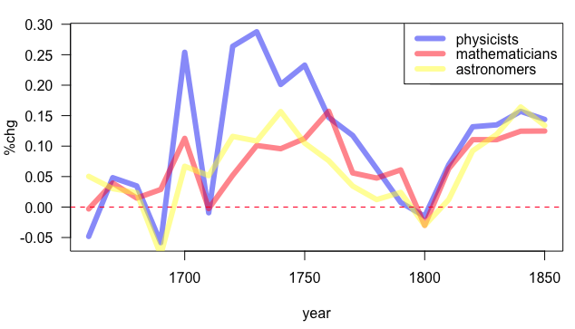

This is going to be a rambling post in which I try to use economic reasoning to explain why different people have such different reactions to the sudden and ominous rise of AI in mathematics. But I'd like to begin by discussing some seemingly unrelated topics.

Exhibit A: English billiards. This is a game played on what is nowadays called a snooker table. Throughout the nineteenth and early twentieth century, the game of choice to play on such a table was billiards, not snooker. Billiards is a game played with just three balls in which the players attempt to score points by potting their own ball, potting their opponent's ball, or hitting both of the other balls. By the early twentieth century, it was already apparent that the best players were getting very good at billiards. In 1907, Tom Reece [spent several weeks](https://allaboutsnooker.info/sdc_download/3702/?key=0w96zwwaddh108yf19f6kfqt0cboc1) setting a world record using a technique which could score an unlimited number of points. The rules were changed. But this did not stop Walter Lindrum, an Australian player who introduced the "Lindrum movement", a highly-complex series of shots which, despite various additional rule changes, allowed him to score an essentially unlimited number of points at will. By the 1950s, billiards had collapsed in popularity. It turns out that it isn't fun to watch the game anymore if people are too good at it.

Nowadays billiards is still played, but only on an amateur level. The best contemporary player is [Dave Causier](https://world-billiards.com/dave-causier-profile/), a pub landlord from Middlesborough. Although he is [unbelievably good](https://www.youtube.com/watch?v=YoLcG8LDvg0), he is not as good as Lindrum. Nobody is. It is often said that Lindrum was so good that he killed billiards as a competitive sport.

Exhibit B: If you eat at the German fast food restaurant *Nordsee* (North Sea) which has branches everywhere, you will often see *Viktoriasee-Barsch* on the menu. This fish does not live in the North Sea. As its name implies, it lives in Lake Victoria. In fact, it is practically the only species of fish in Lake Victoria. But it is not native to Lake Victoria. It was introduced at some point and then it ate all the other fish in Lake Victoria. The story of how this happened was made into a documentary film called *Darwin's Nightmare*.

Exhibit C: The amenability of Thompson's group $F$. This was for many years an open problem. One of the things that made it so exciting to follow was that there was no consensus about whether the answer should be yes or no. People kept coming up with flawed proofs which claimed to settle the question one way or the other. I don't understand much about the problem myself, but Justin Moore, a mathematician from Cornell, was very good at making it sound exciting. The problem was settled as part of a [massive dump of papers generated by OpenAI](https://en.wikipedia.org/wiki/OpenAI_bulk_release_of_mathematical_papers) on October 6, 2026. Unlike some of the other OpenAI results, the proof seems to have been human-verified by [Kim and Lodha](https://arxiv.org/abs/2610.18360). Moore [wrote a pretty heartfelt response](https://justintatchmoore.github.io/homepage/10-6-2026.html) to the news which is well worth reading. He described the proof (using a wonderfully American metaphor) as

> a pellet of lead in a shotgun blast.

Indeed, there was something violent about the OpenAI paper dump. The goal of the exercise was presumably to demonstrate that the OpenAI model had the power to generate new mathematical proofs. The people who generated the proofs don't care about mathematics (this is evident if you try to read them[1](#footnote1)) but they *do* care very much about money. At the moment, they are locked in competition with other companies to see who can build the best AI model. (Since, as I've [argued elsewhere](https://datascienceconfidential.github.io/economics/ai/llm/r/2026/01/07/so-how-much-does-openai-owe-us.html), the Cover-Hart theorem implies that the model's performance depends mostly on the training data, these companies basically all have pretty much the same model, and are really competing to see who has managed to steal the most data. But the models, even if they're just tools for extracting information from an enormous mass of stolen data, are still remarkably powerful. They just proved the Riemann Hypothesis, for goodness' sake!) Whoever wins expects to get all of the money. Mathematicians are just collateral damage.

What about people who care about mathematics? What are mathematicians supposed to do if proofs can be generated by a machine? What is the value of mathematics anyway? How does the economy of mathematics work? Have any economists thought about this?

Surprisingly, at least one has. And in fact it was none other than Adam Smith. Unlike poets, he says, mathematicians

> are frequently very indifferent about the reception which they may meet with from the public. The two greatest mathematicians that I ever have had the honour to be known to, and, I believe, the two greatest that have lived in my time, [Dr Robert Simpson](https://mathshistory.st-andrews.ac.uk/Biographies/Simson/) of Glasgow[2](#footnote2), and [Dr Matthew Stewart](https://mathshistory.st-andrews.ac.uk/Biographies/Stewart/) of Edinburgh, never seemed to feel even the slightest uneasiness from the neglect with which the ignorance of the public received some of their most valuable works. The great work of Sir Isaac Newton, his Mathematical Principles of Natural Philosophy, I have been told, was for several years neglected by the public. The tranquillity of that great man, it is probable, never suffered, upon that account, the interruption of a single quarter of an hour[3](#footnote3).

It may be that mathematicians (here I am only considering pure mathematicians[4](#footnote4)) don't care what the *public* thinks about their results, but they do care very much about what other mathematicians think about their results. Mathematical theorems are nothing more than true statements[5](#footnote5). I claim that the value of showing that one of these statements is true is entirely social. It might appear that some proofs gain value from the fact that other mathematicians have tried and failed to prove the statement, but those others only tried because they happened to think that it was interesting. Similarly, it may seem that some proofs are more valuable than others because they are related to important mathematical topics or goals, but why are these goals important? Because other people think they are.

Mathematicians prove theorems. They are rewarded for proving theorems with academic jobs and prizes. The theorems get their value not from any innate qualities they possess but, like everything else, from what other people are prepared to pay for them. This payment might not come in the form of something as crude as money; it might just be the recognition that something has been achieved. Perelman [refused to accept a million-dollar prize](https://www.theguardian.com/world/2010/mar/23/grigory-perelman-rejects-1m-dollars). But he didn't refuse to say that he had proved the Poincaré conjecture. Or as mountaineer [Billi Bierling](https://www.bbc.com/future/article/20151008-the-graveyard-in-the-clouds-everests-200-dead-bodies) put it:

> Somebody once said that climbing Mount Everest is a challenge, but the bigger challenge would be to climb it and not tell anybody.

For example, I remember an old supervisor of mine telling me an anecdote about an undergraduate friend of his who had invented a subject which he called Box Theory. The friend had proved a theorem classifying all abelian boxes. My supervisor said that Box Theory was useless because there was no reason for anyone to be interested in it. (I've always wondered what Box Theory was, but then I'm attracted to quixotic and dead-end mathematical results, for example the [recent proof](https://arxiv.org/abs/2403.13855) that there is an infinite game of beggar-my-neighbour.)

Some prominent mathematicians are welcoming the arrival of AI. They say that proving theorems was never much fun. [A few years ago, in a different context, Kevin Buzzard said](https://mathoverflow.net/questions/351640/extent-of-unscientific-and-of-wrong-papers-in-research-mathematics/351726#351726) that proof is not the essential thing, and that:

> Working out what is true is the hard, fun, and interesting part.

But the fact is that, despite the left-leaning sympathies of many prominent mathematicians, mathematics is a brutally capitalist endeavour. The way to gain social credibility is to prove things that other mathematicians think are important. There is no other way to get into mathematics. Unlike [other academic subjects](https://datascienceconfidential.github.io/nlp/llm/2024/02/23/onegin-markov.html) (even some sciences) mathematics is a pure meritocracy. Everyone who obtained an academic position got it because they were the first to prove something. Unlike capitalism itself, nobody gets a head start. When I was researching this post, I discovered that even Euler had to start from zero like everyone else[6](#footnote6). It's been like this for centuries. And the system works pretty well.

From this point of view, mathematicians are divided into two kinds of people: those who have to prove things, and those who have gained enough social credit that they no longer have to prove things. In 2013 some prominent matroid theorists announced a proof of [Rota's conjecture](https://en.wikipedia.org/wiki/Rota%27s_conjecture). The proof never actually appeared. Nevertheless, given that the people who claimed to prove it had acquired a lot of social credit by proving other things, it's widely believed that it *has* been proved. When prominent mathematicians announce that proving things isn't important anyway, it might look like a sort of aristocratic disdain for trade, but it must be remembered that they got to the top by climbing the same ladders as everybody else.

So what happens when these ladders are kicked away? If we have a mysterious oracle which can prove any statement which we can imagine, how can anybody at the bottom ever ascend to the heights of mathematics? What would a mathematical society in which proofs are abundant look like?

Fortunately, we might not need to guess, because something very like this has happened before. Between roughly 1740 and 1770, mathematics was dominated by Leonhard Euler to such an extent that everyone was terrified that Euler would anticipate their results. [An anecdote reported by W. W. Rouse Ball tells us](http://euclid.trentu.ca/math/sb/history/Winter-2019/A-Short-Account-of-the-History-of-Mathematics.pdf) that the young Lagrange wrote to Euler and persuaded him to withhold some results on the calculus of variations so that Lagrange could publish them first.

Did Euler's presence have a chilling effect on mathematics? I couldn't find any evidence that it did. A thoroughly unscientific study using my new favourite source of questionable data, Wikidata, produced the following graph showing year-on-year growth in the number of mathematicians, physicists, and astronomers between 1650 and 1850. I can't see any interesting differences between the three lines in the graph. If there was a decrease in the growth rate of the number of new mathematicians, I don't think it was because of mathematicians. I can't seriously believe that Euler's superhuman abilities dissuaded people from doing mathematics.

 

Still, I'm very glad that I'm not a PhD student right now. It must be terrifying waking up every morning to wonder whether your research project has been scooped by someone who has fed it into a pay-to-play machine. The closest parallel from my own time was when Perelman unexpectedly proved the Poincaré conjecture. Since this conjecture was the motivation for a lot of research at the time, I have heard him referred to as "the face that sank a thousand theses". It would be nice if those senior mathematicians who have accumulated enough social capital to be able to say that "proving things is not important" could understand this point.

In the short run, I think that AI is going to lead to a lot of pain for the people trying to become mathematicians. Like in every other field, it seems to be killing the entry level jobs first. But what happens in the long run? I can imagine three possible futures, which finally brings us back to where we started.

First, there's the "billiards" scenario. Like Walter Lindrum, AI models dominate mathematics. Economically, mathematics dies. There are no longer any rewards to motivate people to prove theorems. But some people are still fascinated by mathematics, and it continues on an amateur level, among people who are not motivated by money. In other words, it becomes a playground for the rich, as it was for much of its history.

Second, there's the "Lake Victoria" scenario. Competition intensifies. Everyone rushes to get the best AI model. Research happens in increasing secrecy. Results are jealously guarded, as they were in the Renaissance era. Fluffy collaboration is replaced by ruthless competition. In this scenario, everybody essentially ends up in the lower tier of mathematicians, and the mathematical aristocracy no longer exists. In other words, it's the exact opposite of the first scenario.

Third, there's the scenario in which the current incentive structure stays in place, but the emphasis shifts from generating proofs to creating interesting mathematical objects. Mathematicians still try to find out what is true, but demonstrating that something is true becomes cheap, and so no longer has the value that it did in the past. I think that this is the likeliest scenario for two reasons.

Firstly, current institutions aren't likely to die easily, if only because of inertia. For example, are journals going to shut down because of AI, or is it more likely that they will simply change the kinds of things which they publish? I think it's more likely that they will change the things that they publish. The value of expository work will go up relative to proofs[7](#footnote7). PhDs will be awarded for inventing or explaining mathematics rather than "doing" it. We can never run out of mathematics to invent.

Secondly, there's some evidence that things are already trending in this direction. The [Online Encyclopedia of Integer Sequences (OEIS)](https://oeis.org/) is a well-known resource among mathematicians. It's a huge database of sequences. The idea is that if you run into an interesting sequence in your work, you can check it against the database and see whether it's connected to some other area of mathematics. Recently the OEIS ran its [400k competition](https://oeis.org/wiki/A400K_Winners). This was a competition with the aim of inventing an interesting mathematical object, not with the aim of proving something. True, the reward was not monetary. But surely it's a hopeful sign of things to come?

__________________________

<small>
<a name="footnote1">1</a>: There's something very [Monkey's Paw](https://www.sfu.ca/~swartz/monkeys_paw.htm) about the whole scenario. You are granted the answer to any mathematical question, but all of it is explained in the style of a [viXra](https://vixra.org/) preprint.
</small>

<small>
<a name="footnote2">2</a>: I believe that "Robert Simpson" refers to Robert Simson of Glasgow rather than [Thomas Simpson](https://en.wikipedia.org/wiki/Thomas_Simpson), a self-taught mathematician from England who introduced the abbreviations $sin$, $cos$ and $tan$ for the trigonometric functions. This is the Simpson after whom Simpson's Rule is named.
</small>

<small>
<a name="footnote3">3</a>: This is a typically Smithian passage. It starts with a wildly false claim (Simson and Stewart were decidedly not the greatest mathematicians of the age) which is then backed up by a second "confirmatory" claim which, if you read it carefully, is actually just something he made up. Yet his point seems to be very plausible.
</small>

<small>
<a name="footnote4">4</a>: I know that some readers will probably whine about elliptic curves and cryptography, but the point is that, at the time when pure mathematics is funded, it usually doesn't have any immediate applications, and most research in pure mathematics never gets applied to anything. Applied mathematicians, on the other hand, do seem to care about how their work is reported. I had a friend who once got negative press in the *Daily Mail* for doing mathematics related (among other things) to undulations in carpets.
</small>

<small>
<a name="footnote5">5</a>: A Belgian friend once proudly explained to me that the Dutch word for mathematics is *Wiskunde* which means "the study of that which is true".
</small>

<small>
<a name="footnote6">6</a>: According to Wikipedia, Euler started out by failing to get a position at the University of Basel and then coming second in a competition to work out the best way to place the masts on a ship.
</small>

<small>
<a name="footnote7">7</a>: Right now, proofs are valued much more highly than expositions or explanations. For example, in 2006 Cao and Zhu received a lot of backlash for writing a detailed exposition of Perelman's proof of the Poincaré conjecture (mentioned above). A New Yorker article claiming that Cao and Zhu were trying to steal the credit for the proof became so famous that it has [its own Wikipedia page.](https://en.wikipedia.org/wiki/Manifold_Destiny)
</small>